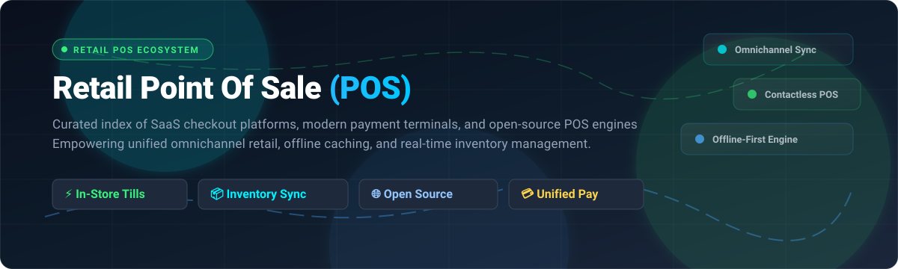

# 🛍️ Awesome-Retail-Point-Of-Sale-POS

  

  
  
  
  
  
  
  

> 🛒 A curated directory of the best **Retail Point of Sale (POS)** SaaS platforms, cloud checkout software, and open-source POS GitHub repositories. Compare pricing tiers, free tier limits, company valuation scale, and GitHub star ratings across in-store till checkout, omnichannel inventory sync, and modern retail management systems.

---

## 📑 Table of Contents

- [📊 Sector Overview & Market Dynamics](#-sector-overview--market-dynamics)
- [☁️ SaaS & Hosted Retail POS Platforms](#️-saas--hosted-retail-pos-platforms)
- [💻 Open-Source GitHub Projects](#-open-source-github-projects)
- [🎯 How to Choose a Retail POS](#-how-to-choose-a-retail-pos)
- [🤝 How to Contribute](#-how-to-contribute)
- [💖 Support & Sponsorship](#-support--sponsorship)
- [📈 Star History](#-star-history)
- [⚖️ Disclaimer](#️-disclaimer)

---

## 📊 Sector Overview & Market Dynamics

The global retail point of sale (POS) market is valued at approximately **$36.5B to $39.2B in 2025–2026** and is projected to expand at a compound annual growth rate (CAGR) of **9.8% to 14.1%**, propelled by omnichannel commerce, cloud modernization, contactless NFC payments, and AI-assisted inventory operations. The sector is **heavily fragmented** rather than winner-take-all; multinational payment infrastructure giants (PayPal, Fiserv/Clover, Block/Square, Shopify) compete against vertical retail software specialists (Lightspeed, Epos Now, Erply) and thousands of regional independent software vendors (ISVs) serving localized tax, hardware, and payment acquiring requirements.

---

## ☁️ SaaS & Hosted Retail POS Platforms

The table below compares commercial retail POS systems sorted by **company scale (market valuation / parent revenue) in descending order**:

| Platform | Pricing (Starting Paid Tier) | Free Tier Limit / Trial Duration & Limits | Company Scale (Valuation / Parent Revenue) | Key Strengths & Target Use Case |
| :--- | :--- | :--- | :--- | :--- |
| **[QuickBooks POS](https://quickbooks.intuit.com/)** | $1,200 one-time software license (or $35/mo via QuickBooks Online ecosystem) | **30-day free trial** with full software feature access; no credit card required | **~$180B Market Cap** (Parent: Intuit; ~$16.3B Annual Revenue) | Seamless accounting sync with QuickBooks Desktop and QBO; legacy enterprise retail setups. |
| **[Shopify POS Lite](https://apps.shopify.com/shopify-pos)** | $39/month (included with Shopify Basic plan, billed monthly; $29/mo billed annually) + 2.9% + 30¢ online / 2.7% card-present | **3-day free trial** (unrestricted dashboard setup; payment gateway testing enabled, but live sales checkout locked until paid/promotional selection) | **~$140B Market Cap** (~$8.9B Annual Revenue) | Pop-ups, market vendors, and existing Shopify ecommerce merchants requiring unified omnichannel catalog & inventory sync. |
| **[Shopify POS Pro](https://apps.shopify.com/shopify-pos)** | $89/month per location (add-on to Shopify plans) + retail hardware costs | **3-day free trial** of Shopify base plan; select 30-day POS Pro trials provided via retail sales consultations | **~$140B Market Cap** (~$8.9B Annual Revenue) | Dedicated multi-register brick-and-mortar stores requiring custom printed receipts, granular staff roles, exchanges, and daily shift cash reconciliation. |
| **[Zettle by PayPal](https://www.zettle.com/)** | **$0/month subscription**; pay-as-you-go processing fee of 1.75% per card transaction (card-present) and 2.29% + $0.09 online | **Free forever plan** with $0 monthly recurring fees; full POS app access with unlimited products, users, and transactions; fee charged strictly per processed sale | **~$70B Market Cap** (Parent: PayPal; ~$31.8B Annual Revenue) | Micro-retailers, boutiques, and pop-up merchants seeking zero recurring software overhead with mobile tap-to-pay. |
| **[Clover Mini](https://www.clover.com/)** | $45/month for 36-month lease (or $849 one-time hardware purchase) + 2.6% + 10¢ card-present transaction fee | **90-day software fee waiver trial** on select plans (hardware purchase/lease and standard card transaction fees still apply; 1 trial per Tax ID) | **~$60B Market Cap** (Parent: Fiserv; ~$20.5B Annual Revenue) | Countertop retail environments needing integrated card readers, customer-facing touchscreens, and rapid barcode scanning. |
| **[Square for Retail](https://squareup.com/)** | **$0/month Free Tier**; **$109/month per location** for Square for Retail Plus (+ 2.6% + 10¢ in-person transactions) | **Free forever plan** with $0/month fee on unlimited items, basic inventory, and single register per location; **30-day free trial** available for Retail Plus | **~$50B Market Cap** (Parent: Block, Inc.; ~$24.0B Annual Revenue) | Versatile small-to-medium retail shops wanting zero upfront software commitment and turn-key hardware terminals. |
| **[Lightspeed Retail](https://www.lightspeedhq.com/)** | $109/month (Basic plan, billed annually) or $139/month (billed monthly) with embedded Lightspeed Payments | **14-day free trial** with full software feature access across inventory, reporting, and customer catalog; no credit card required | **~$2.5B Valuation / Market Cap** (~$1.1B Annual Revenue) | Sophisticated multi-store retail brands, bike shops, apparel, and high-SKU catalog retailers requiring advanced supply chain reordering. |
| **[Erply](https://erply.com/)** | $99/month per location (Annual commitment) or $129/month month-to-month | **14-day free trial** with full access to point of sale, offline-mode terminal, and back-office stock manager; no credit card required | **Private (~$150M–$250M Est. Valuation)** | Mid-market chains, franchises, and multi-warehouse retailers needing robust enterprise offline-first POS capabilities. |
| **[Epos Now](https://www.eposnow.com/)** | $39/month cloud software subscription (typically bundled with $349–$899 upfront hardware terminal package) | **No self-service free trial**; offers guided interactive 1-on-1 virtual product demos with sales engineers | **Private (~$400M–$600M Est. Valuation)** | Retail storefronts, convenience stores, and hybrid retail/hospitality venues seeking full touchscreen terminal bundles. |
| **[Hike POS](https://hikeup.com/)** | $59/month (Essential plan, 1 store, billed annually) or $69/month (month-to-month); $99/month for Plus multi-store | **14-day free trial** with unlimited inventory entries, POS checkout simulator, and reporting; outgoing manual customer emails restricted during trial | **Private (~$20M–$50M Est. Valuation)** | Independent retail shops wanting a cloud POS that integrates with existing merchant accounts (0% added transaction markups). |

---

## 💻 Open-Source GitHub Projects

Explore top community-driven, self-hosted, and open-source point of sale engines. Repositories are ranked below by **GitHub Stargazers in descending order**:

| Project | GitHub Stars | Primary Tech Stack | License | Description & Architectural Highlights |
| :--- | :---: | :--- | :--- | :--- |
| **[Odoo POS](https://github.com/odoo/odoo)** |  | Python, JavaScript (OWL), PostgreSQL | LGPL-3.0 | Enterprise-grade POS module integrated natively with Odoo ERP, automated accounting, multi-warehouse inventory, and eCommerce. Includes offline browser caching. |
| **[ERPNext POS](https://github.com/frappe/erpnext)** |  | Python (Frappe Framework), MariaDB, Vue.js | GPL-3.0 | Complete open-source business suite with an integrated retail Point of Sale cashier interface, serial number tracking, batch inventory, and multi-currency billing. |
| **[BTCPay Server POS](https://github.com/btcpayserver/btcpayserver)** |  | C#, .NET Core, Vue.js | MIT | Self-hosted, non-custodial cryptocurrency Point of Sale application enabling physical retail stores to accept Bitcoin and Lightning Network payments with zero fees. |
| **[OSPOS (Open Source Point of Sale)](https://github.com/opensourcepos/opensourcepos)** |  | PHP (CodeIgniter), MySQL, Bootstrap | MIT | Clean, lightweight web POS for small and medium businesses. Features barcode generation, stock receiving, daily sales reporting, customer tracking, and receipt printing. |
| **[NexoPOS](https://github.com/Blair2004/NexoPOS)** |  | PHP (Laravel), Vue.js, Tailwind CSS | MIT | Modern, responsive web POS software with intuitive register operations, cashier shift cash-management, barcode scanning, customer ledgers, and extensible plugin architecture. |
| **[Store-POS](https://github.com/tngoman/Store-POS)** |  | Electron, React, Node.js, SQLite | MIT | Modern desktop POS application for Windows and Linux. Offers offline-first local SQLite storage, LAN-based multi-terminal synchronization, visual product catalog, and receipt printing. |
| **[Lakasir](https://github.com/lakasir/lakasir)** |  | PHP (Laravel), Vue.js | GPL-3.0 | Lightweight and straightforward Point of Sale system created for small retail stalls, grocery shops, and minimarts requiring simple transaction recording. |
| **[TailPOS](https://github.com/bailabs/tailpos)** |  | Python, Kivy, ERPNext API | GPL-3.0 | Offline-first mobile and tablet POS application that synchronizes transactions, items, and inventory balances seamlessly with ERPNext cloud instances. |
| **[POS Awesome](https://github.com/ucraft-com/POS-Awesome)** |  | Vue.js, Vuetify, Frappe Framework | MIT | Modern, fast cashier UI alternative for ERPNext with offline-first indexedDB transaction persistence, touch register layout, and instant customer search. |
| **[Laravel POS](https://github.com/angkosal/laravel-pos)** |  | PHP (Laravel), Bootstrap, MySQL | MIT | Minimalist web-based POS solution for developers and retail merchants looking for clean Codebase architecture to manage products, categories, orders, and sales receipts. |
| **[WallacePOS](https://github.com/micwallace/wallacepos)** |  | PHP, JavaScript, IndexedDB, MySQL | GPL-3.0 | Web-based point of sale with offline local caching, touchscreen-ready interface, thermal receipt printer support, barcode reader integration, and end-of-day reporting. |
| **[Floreant POS](https://github.com/floreantpos/floreantpos)** |  | Java, Swing, Derby / MySQL | GPL-2.0 | Proven desktop POS application tailored for restaurant, bakery, and food-retail environments. Features table layout management, kitchen display printing, and cashier sessions. |
| **[ChromisPOS](https://github.com/ChromisPos/ChromisPOS)** |  | Java, Apache Derby, MySQL | GPL-3.0 | Feature-rich desktop retail point of sale engine derived from the uniCenta POS lineage with multi-terminal support, barcode scanners, customer-facing pole displays, and cash drawers. |
| **[Ready POS for WooCommerce](https://github.com/Johuniq/ready-pos)** |  | PHP (WordPress Plugin), React, Tailwind CSS | GPL-2.0+ | Fullscreen web POS terminal plugin for WooCommerce stores. Provides real-time store inventory sync, cash drawer balancing sessions, customer lookups, and split payments. |

---

## 🎯 How to Choose a Retail POS

When evaluating retail POS solutions for single-store boutiques, multi-location chains, or omnichannel operations, consider these key evaluation pillars:

1. 🔌 **Integrated Hardware & Peripherals**: Verify support for cash drawers, ESC/POS thermal receipt printers, 1D/2D barcode scanners, scales, and EMV/NFC payment terminals.
2. ⚡ **Offline-Mode Resilience**: Look for local SQLite or indexedDB client-side caching so registers can continue ringing sales during internet disruptions.
3. 🔄 **Omnichannel Inventory Synchronization**: Ensure real-time inventory updates across physical checkouts, web stores (Shopify, WooCommerce, Magento), and marketplace listings.
4. 💳 **Payment Processing Freedom**: Decide whether you prefer bundled processing (Shopify Payments, Square, Clover) or bring-your-own-merchant-account gateways (Hike POS, Odoo, NexoPOS) to optimize interchange fees.
5. 🛡️ **Data Ownership & Security**: Self-hosted open-source stacks provide complete sovereignty over customer records, while hosted SaaS platforms handle PCI DSS compliance and cloud backups out of the box.

---

## 🤝 How to Contribute

We welcome contributions from merchants, engineers, and retail software developers:

1. 🍴 Fork this repository.
2. 🌿 Create a new branch: `git checkout -b feature/add-new-pos`.
3. 📝 Add the SaaS platform or open-source repo in appropriate markdown table sorted by valuation or star count.
4. 🔍 Ensure all links are active, pricing/limits are factual, and GitHub star badges follow `style=social&color=white`.
5. 🚀 Submit a pull request with a descriptive title and explanation.

---

## 💖 Support & Sponsorship

Thank you for exploring this curated repository! If you find this retail point-of-sale directory helpful for your business, engineering architecture, or research, please consider supporting the project:

- ⭐ **Star this repository** to help others discover it on GitHub.
- 🍴 **Fork and share** it with fellow retail store operators, engineers, and founders.
- ☕ **Buy me a coffee / Sponsor**: Support ongoing maintenance and curation via the [GitHub Sponsors Dashboard](https://github.com/sponsors/ishandutta2007).

Your backing helps keep this ecosystem active, up-to-date, and comprehensive!

---

## 📈 Star History

---

## ⚖️ Disclaimer

- This list is community-curated for informational and architectural comparison purposes.
- Mentions of specific brands, trademarks, and logos belong to their respective copyright holders and do not constitute commercial endorsement.
- Ensure all live point of sale deployments handling credit card information strictly comply with **PCI DSS (Payment Card Industry Data Security Standard)** guidelines.
